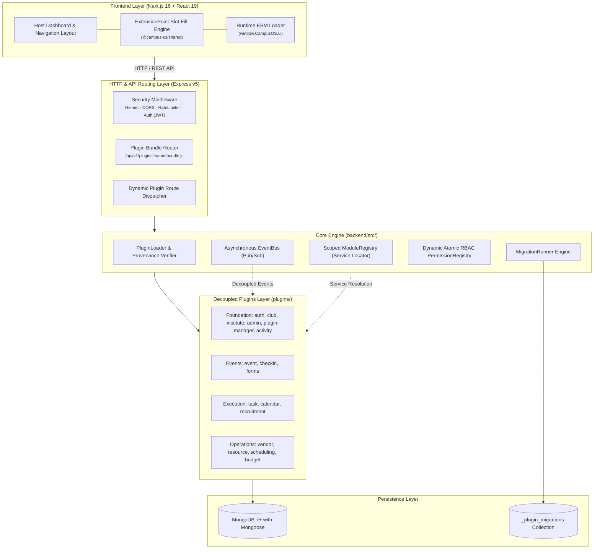
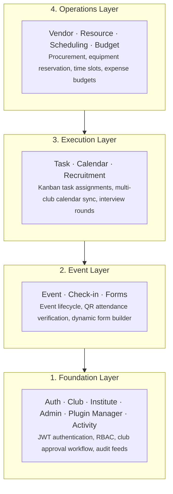

# Architecture Overview

CampusOS is an extensible, modular operating system designed for higher education campuses. It is architected around two core principles: **every business capability is an isolated plugin**, and **plugins never import each other directly**.

## System Architecture

## System Layers

Modules are organized into 4 vertical layers. Lower foundation layers provide fundamental entities, while higher layers compose them into event and operations workflows:

### Module Distribution & Storage

| Layer          | Modules                                                            | Core Responsibilities                                                                          | Storage Pattern                                               |
| -------------- | ------------------------------------------------------------------ | ---------------------------------------------------------------------------------------------- | ------------------------------------------------------------- |
| **Foundation** | `auth`, `club`, `institute`, `admin`, `plugin-manager`, `activity` | User accounts, sessions, multi-role club approval state machine, audit logs, plugin management | MongoDB (`users`, `clubs`, `plugins`, `activities`)           |
| **Event**      | `event`, `checkin`, `forms`                                        | Event publishing, RSVP tickets, QR check-in scanning, dynamic surveys and submissions          | MongoDB (`events`, `checkins`, `forms`, `form_responses`)     |
| **Execution**  | `task`, `calendar`, `recruitment`                                  | Kanban task boards, persistent multi-club calendar sync, applicant tracking system             | MongoDB (`tasks`, `calendar_events`, `recruitment_campaigns`) |
| **Operations** | `vendor`, `resource`, `scheduling`, `budget`                       | Vendor contracts, inventory tracking, conflict-free room scheduling, expense allocations       | MongoDB (`vendors`, `resources`, `schedules`, `budgets`)      |

> **Persistence Guarantee**: All plugins utilize MongoDB with Mongoose repositories. Memory-based mock storage has been completely superseded by isolated in-memory MongoDB replica sets during testing (`mongodb-memory-server`).

## Core Architecture Principles

### 1. Every Feature is an Autonomous Plugin

Feature implementations reside exclusively in `/plugins/<module>/`. The backend core (`backend/src/`) provides server orchestration, security middleware, and lifecycle management, but contains zero feature business logic.

### 2. Zero Direct Module-to-Module Imports

Cross-module imports (e.g. `import ... from '../../club/...'`) are strictly prohibited and enforced via architectural linters. Cross-boundary communication happens through 3 sanctioned channels:

- **Service Registry (`registry.getService`)**: For synchronous interfaces and domain capabilities. Direct database access is restricted to verified core plugins; community plugins communicate strictly via business services (ADR-017).
- **Core EventBus (`eventBus.emit` / `eventBus.on`)**: For decoupled domain events (e.g. `club:created`, `event:published`).
- **Database Repositories**: Read-only access to shared schema contracts through Mongoose models (core plugins only).

### 3. Automated Database Migrations

Plugins maintain their own database schema evolution via `backend/migrations/`. Migrations execute deterministically upon startup with checksum tamper-proofing, guaranteeing consistent schema state across local, staging, and production environments.

### 4. Slot-Fill Frontend Integration

The frontend does not bundle separate single-page applications or iframes. Features register modular React widgets into host **Extension Points** (e.g. `dashboard-top`, `dashboard-stats`, `club-header-actions`), wrapped in `ExtensionErrorBoundary` isolators.

## Tech Stack Overview

| Component              | Technology                         | Rationale                                                                      |
| ---------------------- | ---------------------------------- | ------------------------------------------------------------------------------ |
| **Backend Engine**     | Node.js 18+ & Express **v5**       | Native async handler support without wrapping; modern ES module architecture.  |
| **Frontend Framework** | Next.js 16 (App Router) + React 19 | Server-side rendering, React Server Components, and Turbopack compiler.        |
| **Database & ODM**     | MongoDB 7+ & Mongoose              | Flexible schema modeling, compound indexes, and document atomicity.            |
| **Shared Contracts**   | `@campus-os/shared` (TS / ESM)     | Shared Zod schemas, extension point definitions, and plugin interfaces.        |
| **Styling & UI**       | Tailwind CSS v4 & shadcn/ui        | Utility-first styling with accessible, tokenized Radix primitives.             |
| **State Management**   | Zustand                            | Lightweight, hook-based client store decoupled from component tree.            |
| **Testing**            | Vitest + `mongodb-memory-server`   | Lightning-fast test runner with isolated in-memory MongoDB replica execution.  |
| **Package Manager**    | pnpm (Monorepo Workspaces)         | Strict dependency isolation, symlinked node_modules, and fast build pipelines. |

## Non-Negotiable Architectural Rules

1. **Manifest Required**: Every plugin directory must contain a valid, Zod-compliant `plugin.json` manifest.
2. **Standardized Directory Layout**: Plugins must follow the `backend/` and `frontend/` separation.
3. **Lifecycle Compliance**: Plugins must export `init(app, registry, eventBus, logger)` and handle graceful teardown in `destroy()`.
4. **No Unhandled Background Leaks**: Recurring intervals and timeouts must be registered via `registry.timers` to avoid memory leaks.
5. **ES Modules Only**: Strict `import`/`export` syntax across both backend and frontend. `require()` is forbidden.

---

**See Also**: [Backend Architecture](./BACKEND.md) · [Plugin System](./PLUGIN_SYSTEM.md) · [Event Catalog](./EVENT_CATALOG.md) · [Architecture Decision Records (ADRs)](./decisions/README.md)
