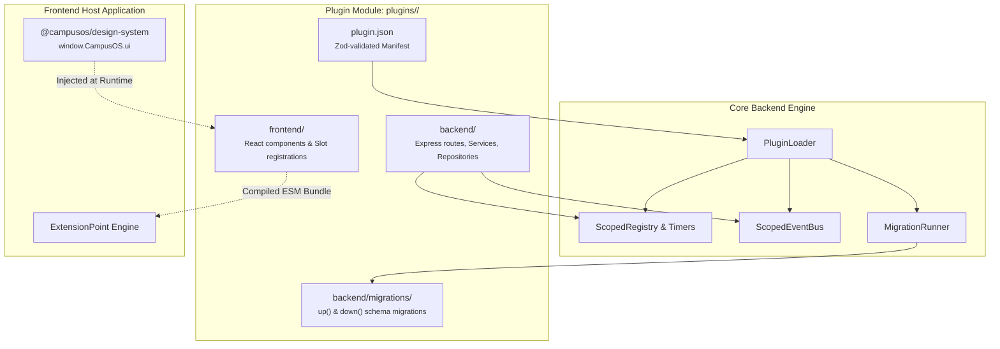
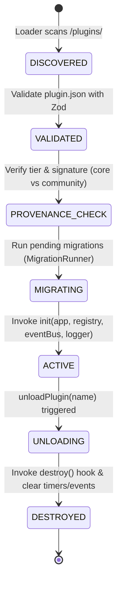
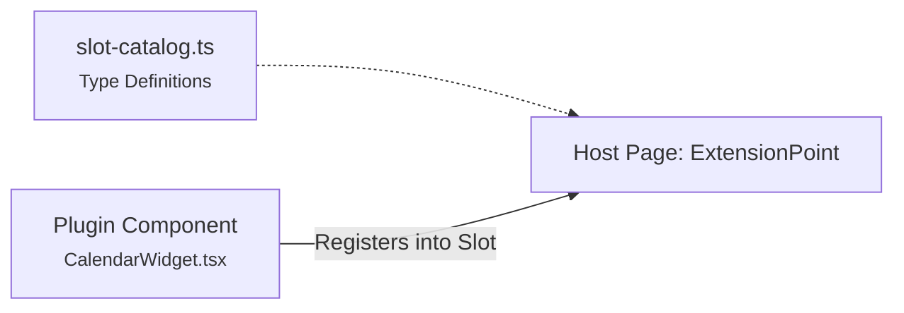

# Plugin System

Every feature in CampusOS is an isolated, modular plugin in `/plugins/`. Plugins are loaded dynamically at runtime — the core engine never hardcodes module implementations or schemas.

## High-Level Architecture

CampusOS implements a decoupled, two-tier plugin model where backend services and frontend UI widgets live together in a single plugin module:



## Plugin Manifest Specification (`plugin.json`)

Every plugin **must** include a `plugin.json` manifest at its root (`plugins/<name>/plugin.json`). The manifest serves as the single source of truth for plugin identity, provenance security tier (`core` vs `community`), capability requests, database engine, and topological dependency resolution.

```json
{
  "name": "calendar",
  "version": "1.0.0",
  "description": "Campus event scheduling and calendar planning",
  "tier": "community",
  "defaultEnabled": true,
  "backend": true,
  "frontend": true,
  "dependencies": {
    "auth": "^1.0.0"
  },
  "capabilities": ["service:event", "event:bus:emit"]
}
```

> [!NOTE] Authoritative Manifest Reference
> For the complete field-by-field specification, Zod validation contract, permission rules, and production examples, refer to the dedicated [Plugin Manifest Specification](/docs/plugins/backend/manifest).

## Plugin Directory Structure

Every modular plugin adheres to the standardized monorepo layout:

```
plugins/<module>/
├── plugin.json                 # Manifest with metadata, permissions & slots
├── package.json                # Module-specific dependencies
├── vitest.config.js            # Isolated unit test runner
│
├── backend/                    # Backend implementation
│   ├── src/
│   │   ├── index.js            # Entrypoint — exports init() and destroy()
│   │   ├── controller/         # Express HTTP request handlers
│   │   ├── routes/             # Route definitions & permission bindings
│   │   ├── repository/         # Database access layer (Mongoose)
│   │   ├── schema/             # Mongoose schema definitions
│   │   └── service/            # Core business logic & EventBus hooks
│   └── migrations/             # Schema migration scripts
│       └── 001_initial_schema.js
│
└── frontend/                   # Frontend micro-UI implementation
    ├── init.ts                 # Registers components into slot catalog
    ├── api.ts                  # Typed API client functions
    ├── hooks/                  # React hooks & queries
    └── components/             # React UI components & widgets
```

## Plugin Lifecycle & State Machine (ADR-019)

Plugins transition through a deterministic lifecycle managed by `plugin-loader.js`:



### 1. Initialization (`init`)

Plugins export an `init(app, registry, eventBus, logger)` function:

```javascript
// plugins/calendar/backend/src/index.js
import { CalendarRepository } from './repository/calendar.repository.js';
import { createCalendarService } from './service/calendar.service.js';
import { registerCalendarRoutes } from './routes/calendar.routes.js';

let cleanupTimers = null;

export async function init(app, registry, eventBus, logger) {
  const requirePermissions = registry.getService('requirePermissions');

  const repository = new CalendarRepository();
  const service = createCalendarService(repository, { eventBus, logger });

  // Register routes
  registerCalendarRoutes(app, service, requirePermissions);

  // Subscribe to domain events via scoped EventBus
  eventBus.on('event:published', async (eventData) => {
    await service.syncEventToCalendar(eventData);
  });

  // Background recurring sync using scoped timers (prevents leaks)
  cleanupTimers = registry.timers.setInterval(
    () => {
      service.cleanupStaleReservations();
    },
    1000 * 60 * 60
  );

  logger.info('Calendar plugin initialized');
}
```

### 2. Teardown & Resource Cleanup (`destroy`)

When a plugin is deactivated, `unloadPlugin(name)` invokes the optional `destroy()` hook:

```javascript
export async function destroy(app, registry, eventBus, logger) {
  logger.info('Tearing down calendar plugin resources...');

  if (cleanupTimers) {
    clearInterval(cleanupTimers);
  }

  // Scoped EventBus and Registry automatically unbind all remaining
  // listeners and clear scoped timers if not done manually.
}
```

- **5000ms Timeout Guard**: Prevents hanging shutdown tasks.
- **Dependency Guard**: Refuses deactivation if another active plugin depends on this plugin (unless `force: true` is passed).

## Automated Database Migrations (ADR-021)

Plugins manage database schema evolutions via forward `up()` and rollback `down()` migration scripts placed in `backend/migrations/`:

```javascript
// plugins/calendar/backend/migrations/001_initial_schema.js
export async function up({ db, mongoose, logger }) {
  logger.info('Creating calendar collections and compound indexes');
  const collection = db.collection('calendar_events');
  await collection.createIndex({ clubId: 1, startTime: 1 });
  await collection.createIndex({ 'recurrence.until': 1 }, { sparse: true });
}

export async function down({ db, mongoose, logger }) {
  logger.info('Dropping calendar_events indexes');
  const collection = db.collection('calendar_events');
  await collection.dropIndex('clubId_1_startTime_1');
}
```

- **Execution Order**: Migrations execute sequentially during startup before `init()`.
- **Integrity Tracking**: The `_plugin_migrations` collection stores the execution status, timestamp, and SHA-256 checksum of each migration script. If an applied migration file is tampered with, server startup fails immediately.

## Frontend Extension Point & Slot-Fill System (ADR-020)

CampusOS does not use heavyweight iframe micro-frontends or require full-app rebuilds. Instead, frontend components are injected into designated **Extension Points**:



### How Slot-Fill Works:

1. **Extension Points in Host App**:

   ```tsx
   import { ExtensionPoint } from '@campus-os/shared/extension-point';

   export function Dashboard({ user, activePlugins }) {
     return (
       <div className="grid grid-cols-1 md:grid-cols-3 gap-4">
         <ExtensionPoint
           id="dashboard-stats"
           context={{ user }}
           activePlugins={activePlugins}
         />
       </div>
     );
   }
   ```

2. **Component Registration in Plugin**:

   ```tsx
   // plugins/calendar/frontend/init.ts
   import { registry } from '@campus-os/shared/plugin-registry';
   import { CalendarWidget } from './components/CalendarWidget';

   export function initFrontend() {
     registry.registerWidget('dashboard-stats', 'calendar', CalendarWidget, {
       priority: 20,
       condition: (ctx) => Boolean(ctx?.user?.id)
     });
   }
   ```

3. **Runtime Error Boundary Isolation**:
   Every injected widget is wrapped inside an `ExtensionErrorBoundary`. If a community plugin widget throws an unhandled error, only that widget displays a fallback UI; the rest of the application runs unaffected.

## Runtime ESM Bundling & Design System Injection (ADR-014 & ADR-031)

Frontend plugins are compiled to standalone ESM bundles using `esbuild`. The host application serves the precompiled bundles dynamically:

1. **Host Virtual Module Injection**:
   The host exposes `@campusos/design-system` and React via `window.CampusOS.ui`.
2. **Zero Bundle Duplication**:
   Plugin micro-bundles do not re-bundle React, Lucide icons, or UI primitives. They import from the host runtime at zero bandwidth overhead.
3. **Endpoint**:
   Frontend plugin bundles are served dynamically via:
   `GET /api/v1/plugins/:name/bundle.js`

## Two-Tier Security & Provenance Sandboxing (ADR-017)

To protect the host platform from malicious or unstable community plugins:

| Feature             | Core Plugins (`auth`, `admin`, `plugin-manager`) | Community Plugins                           |
| ------------------- | ------------------------------------------------ | ------------------------------------------- |
| **Provenance**      | Hardcoded official catalog & root signature      | Verified directory metadata                 |
| **Registry Scope**  | Unrestricted `registry` access (`['*']`)         | Sandboxed `ScopedRegistry`                  |
| **EventBus Scope**  | Full broadcast & listen access                   | Restricted to declared event topics         |
| **Database Access** | Global access to core models (`User`, `Plugin`)  | Restricted to plugin-owned collections      |
| **Timers**          | System timers permitted                          | Must use `registry.timers` for leak cleanup |

---

**See Also**: [Backend Architecture](./BACKEND.md) · [Architecture Overview](./OVERVIEW.md) · [Slot Catalog](../plugins/frontend/SLOT_CATALOG.md) · [Event Catalog](./EVENT_CATALOG.md)
