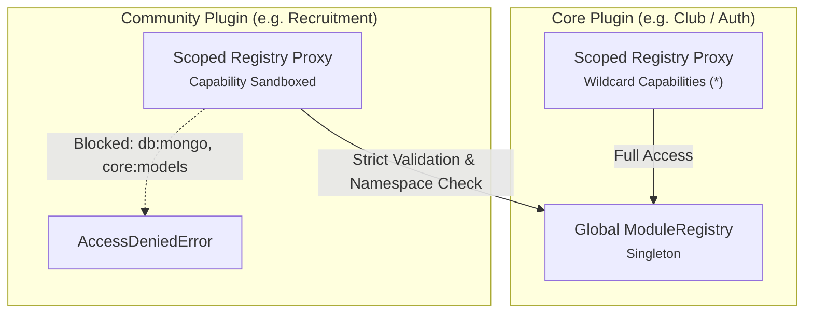
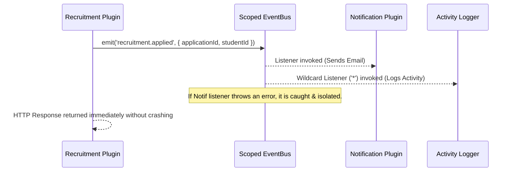

# Backend Primitives & Service Registry

Every backend plugin in CampusOS is dynamically loaded, sandboxed, and initialized by exporting an `init` function from its backend entrypoint:

```
plugins/<plugin-name>/backend/src/index.js
```

```javascript
/**
 * Plugin Entrypoint
 * @param {import('express').Application} app - The Express v5 application instance
 * @param {import('@campus-os/backend/registry').ScopedRegistry} registry - Sandboxed Service Registry
 * @param {import('@campus-os/backend/event-bus').ScopedEventBus} eventBus - Scoped pub/sub event bus
 * @param {import('winston').Logger} logger - Scoped structured logger
 */
export async function init(app, registry, eventBus, logger) {
  logger.info('Initializing plugin...');
  // Mount routes, register services, declare permissions, and listen to events
}
```

The Plugin Loader injects **four core runtime primitives**:

1. **`app`**: The host Express v5 application for mounting REST API endpoints.
2. **`registry`**: The Service Locator & Dependency Injection container for sharing business APIs, atomic RBAC permissions, stat providers, context resolvers, and leak-free timers.
3. **`eventBus`**: The decoupled pub/sub message bus for asynchronous cross-plugin event notification.
4. **`logger`**: The scoped structured Winston logger with automatic plugin tagging and request correlation IDs.

---

## 1. The Service Registry (`registry`)

The **Module Registry** (`backend/src/utils/registry.js`) is the central nervous system of CampusOS. It provides loose coupling and dependency inversion across modular plugins, eliminating brittle relative imports (`../../../../plugins/club/...`) and circular dependency deadlocks.

When a plugin initializes, the host wraps the global registry in a **Scoped Registry Proxy** (`createScopedRegistry`) tailored specifically to the plugin's provenance tier ([ADR-017](/docs/architecture/decisions/ADR-017-TWO_TIER_PLUGIN_SANDBOXING)).



---

### Subsystem A: Cross-Plugin Services

Plugins expose public JavaScript interfaces (services) to other plugins rather than sharing internal database models.

#### Exposing a Service (`registerService`)

```javascript
export async function init(app, registry, eventBus, logger) {
  // Expose a service for other plugins to consume
  registry.registerService('recruitmentService', {
    getApplicantCount: async (clubId) => {
      return await Applicant.countDocuments({ clubId });
    },
    isRecruitingActive: async (clubId) => {
      const cycle = await Cycle.findOne({ clubId, status: 'active' });
      return Boolean(cycle);
    }
  });

  logger.info('Registered recruitmentService');
}
```

- **Immutability Guarantee**: Registered service objects are frozen with `Object.freeze()` to prevent monkey-patching or accidental runtime mutations by consumer plugins.
- **Community Namespacing**: Community plugins must prefix service names with their plugin ID (e.g., `recruitment:service`).

#### Consuming an Upstream Service (`getService`)

Before fetching a service, declare the dependency in your `plugin.json` (`"dependencies": { "club": "^1.0.0" }`).

```javascript
// Safely consume services provided by core or upstream plugins
const clubService = registry.getService('clubService');
const requirePermissions = registry.getService('requirePermissions');

const clubDetails = await clubService.getClubById(req.params.clubId);
```

- If the requested service is missing or disabled in the database, `getService(name)` throws an informative error halting runtime execution rather than silently failing.

---

### Subsystem B: Dynamic Atomic RBAC (`registry.permissions`)

Plugins declare granular, atomic permission tokens that seamlessly integrate into the CampusOS Role-Based Access Control engine ([ADR-012](/docs/architecture/decisions/ADR-012-DYNAMIC_ATOMIC_RBAC)).

```javascript
export async function init(app, registry, eventBus, logger) {
  // Declare permissions in the central permission registry
  registry.permissions.registerAll([
    {
      id: 'recruitment:create_form',
      name: 'Create Recruitment Forms',
      description:
        'Allows club coordinators to create application forms and question templates',
      module: 'recruitment',
      category: 'Coordination'
    },
    {
      id: 'recruitment:review_applicants',
      name: 'Review Applicants',
      description:
        'Allows evaluating student submissions, grading interview rounds, and accepting candidates',
      module: 'recruitment',
      category: 'Evaluation'
    }
  ]);
}
```

#### Permission Methods:

| Method                                    | Description                                                                      |
| :---------------------------------------- | :------------------------------------------------------------------------------- |
| `registry.permissions.register(perm)`     | Registers a single atomic permission descriptor.                                 |
| `registry.permissions.registerAll(perms)` | Registers an array of permission descriptors.                                    |
| `registry.permissions.has(permId)`        | Checks whether a specific permission token is currently registered.              |
| `registry.permissions.get(permId)`        | Retrieves the metadata descriptor for a registered permission.                   |
| `registry.permissions.getAll()`           | Returns an array of all active permissions registered in the system.             |
| `registry.permissions.getAllGrouped()`    | Returns permissions grouped by module for rendering in the Admin Role Matrix UI. |

> [!IMPORTANT] Anti-Squatting Guard
> Community plugins are forbidden from registering permissions belonging to other modules. Community permission tokens **must** start with `<pluginName>:` (e.g. `recruitment:view`). Violations immediately throw `PluginSecurityError`.

---

### Subsystem C: Multi-Tenant Context Resolvers (`registerContextResolver`)

In CampusOS, authorizations are often context-dependent. A student might be a regular member of the "Coding Club", but the President of the "Robotics Club".

A **Context Resolver** inspects incoming HTTP requests matching a route prefix and extracts the dynamic tenant/entity context (such as `clubId` or `organizationId`):

```javascript
export async function init(app, registry, eventBus, logger) {
  // Register context resolver for all /api/v1/clubs/:clubId routes
  registry.registerContextResolver('/api/v1/clubs', async (req) => {
    // 1. Check URL route parameters
    if (req.params?.clubId) return req.params.clubId;

    // 2. Check query string (?clubId=...)
    if (req.query?.clubId) return req.query.clubId;

    // 3. Fallback to request body for POST/PUT
    if (req.body?.clubId) return req.body.clubId;

    return null;
  });
}
```

When `requirePermissions('club:manage')` executes, it invokes `registry.resolveContext(req)`. The permission middleware checks whether the logged-in user possesses the permission token **within that specific club context**.

---

### Subsystem D: Public Route Bypass (`registerPublicRoute`)

By default, CampusOS enforces strict JWT authentication across all API endpoints. If your plugin provides public endpoints (such as public event schedules, open registration forms, or third-party webhooks), register them as public routes:

```javascript
export async function init(app, registry, eventBus, logger) {
  // Allow all GET requests matching /api/v1/recruitment/public/* to bypass JWT auth
  registry.registerPublicRoute(/^\/api\/v1\/recruitment\/public\/.*/, 'GET');

  // Allow webhook receiver across any HTTP method
  registry.registerPublicRoute(/^\/api\/v1\/recruitment\/webhook$/);
}
```

The global JWT authenticator evaluates `registry.getPublicRoutes()` and automatically skips bearer token verification for matched patterns.

---

### Subsystem E: Decentralized Dashboard Stat Providers (`registerStatProvider`)

CampusOS displays a real-time system metrics overview on the administrative dashboard. To prevent the core monolith from querying individual plugin collections directly, plugins provide **Stat Providers**:

```javascript
export async function init(app, registry, eventBus, logger) {
  registry.registerStatProvider('recruitment', async () => {
    const activeApplications = await Application.countDocuments({
      status: 'pending'
    });
    const interviewsScheduled = await Interview.countDocuments({
      date: { $gte: new Date() }
    });

    return [
      {
        label: 'Pending Applications',
        value: activeApplications,
        icon: 'FileText'
      },
      {
        label: 'Upcoming Interviews',
        value: interviewsScheduled,
        icon: 'Calendar'
      }
    ];
  });
}
```

The host `/api/v1/system/dashboard/stats` endpoint queries all registered providers concurrently with timeout protection (`Promise.allSettled`).

---

### Subsystem F: Dynamic Settings Schemas (`registerSettingsConfig`)

Plugins can expose administrative configuration settings without building dedicated frontend configuration screens:

```javascript
export async function init(app, registry, eventBus, logger) {
  registry.registerSettingsConfig('recruitment', {
    title: 'Recruitment Configuration',
    fields: [
      {
        key: 'maxApplicationsPerStudent',
        label: 'Maximum Applications Allowed per Student',
        type: 'number',
        default: 3
      },
      {
        key: 'enableInterviewReminders',
        label: 'Send Automated Email Reminders 2 Hours Before Interview',
        type: 'boolean',
        default: true
      }
    ]
  });
}
```

The CampusOS Admin Portal automatically generates a settings form for the plugin, storing values in the database.

---

### Subsystem G: Leak-Free Scoped Timers (`registry.timers`)

Background timers created with vanilla `setInterval` or `setTimeout` cause severe memory leaks and zombie processes during development hot-reloads and runtime plugin unloads ([ADR-019](/docs/architecture/decisions/ADR-019-PLUGIN_LIFECYCLE_TEARDOWN)).

The scoped registry provides leak-free timer proxies that are **automatically tracked and cleared on teardown**:

```javascript
export async function init(app, registry, eventBus, logger) {
  // Safe: Timer is tracked by the sandbox
  const syncTimer = registry.timers.setInterval(
    async () => {
      logger.info('Running hourly applicant status sync...');
      await syncApplicantStatuses();
    },
    1000 * 60 * 60
  );

  // Manual cancellation if needed:
  // registry.timers.clearInterval(syncTimer);
}

// When the plugin unloads, registry.timers.clearAll() runs automatically.
```

---

## 2. The Scoped EventBus (`eventBus`)

The CampusOS EventBus provides asynchronous, decoupled communication between plugins. It is implemented with an in-memory event engine featuring wildcard topic matching, automatic listener unbinding, and async error isolation.



### Emitting Domain Events (`emit`)

```javascript
export async function submitApplication(req, res) {
  const application = await Application.create(req.body);

  // Emit event asynchronously
  eventBus.emit('recruitment.applied', {
    applicationId: application._id,
    clubId: application.clubId,
    studentId: req.user.id,
    timestamp: new Date().toISOString()
  });

  return res.status(201).json({ success: true, data: application });
}
```

### Subscribing to Events (`on`)

```javascript
export async function init(app, registry, eventBus, logger) {
  // Exact topic matching
  eventBus.on('club.member.resigned', async (data) => {
    logger.info(
      `Cleaning up pending recruitment files for resigned member: ${data.memberId}`
    );
  });

  // Wildcard pattern matching (ADR-008)
  eventBus.on('club.*', async (data, topic) => {
    logger.debug(`Club lifecycle event detected on topic: ${topic}`);
  });
}
```

### EventBus Best Practices:

1. **Pass IDs, Not Mongoose Documents**: Pass lightweight primitive identifiers (`clubId`, `userId`) in the payload rather than full Mongoose document instances.
2. **Strict Topic Namespacing**: Use `<plugin>.<entity>.<action>` dot notation (e.g., `event.session.started`, `recruitment.interview.completed`).
3. **Async Error Isolation**: Listeners should catch their internal errors. Unhandled listener exceptions are caught by the EventBus runner and logged to prevent crashing the main application loop.

---

## 3. The Scoped Logger (`logger`)

CampusOS provides a structured, high-performance logging subsystem built on **Winston**. Every plugin receives an isolated logger instance pre-configured with its plugin identifier and context:

```javascript
logger.info('Applicant evaluation complete', {
  applicantId: 'app_123',
  score: 94
});

logger.warn('Email provider rate limit reached, retrying in 30s', {
  attempt: 2
});

logger.error('Failed to parse resume document', {
  error: err.message,
  stack: err.stack
});
```

### Output Formats:

- **Development**: Colorized, human-readable terminal output:
  ```
  15:04:12 [INFO] [plugin:recruitment] Applicant evaluation complete {"applicantId":"app_123","score":94}
  ```
- **Production**: Machine-readable, single-line structured JSON logs with correlation IDs (`reqId`) ready for ELK, Datadog, or Grafana Loki ingestion:
  ```json
  {
    "timestamp": "2026-11-06T09:34:12.102Z",
    "level": "info",
    "plugin": "recruitment",
    "reqId": "c8f9b2",
    "message": "Applicant evaluation complete",
    "applicantId": "app_123",
    "score": 94
  }
  ```

---

## 4. The Express Application (`app`)

Plugins mount REST API routes directly onto the host Express v5 application.

```javascript
import express from 'express';
import { createRecruitmentRouter } from './routes/recruitment.routes.js';

export async function init(app, registry, eventBus, logger) {
  const router = express.Router();

  // Fetch authentication & authorization middleware from registry
  const requireAuth = registry.getService('requireAuth');
  const requirePermissions = registry.getService('requirePermissions');

  // Mount protected endpoints
  router.get(
    '/applications',
    requireAuth,
    requirePermissions('recruitment:review_applicants'),
    async (req, res) => {
      const applications = await Application.find({ clubId: req.query.clubId });
      res.json({ success: true, data: applications });
    }
  );

  // Mount the router onto standard URL namespace
  app.use('/api/v1/recruitment', router);
}
```

### Express v5 Native Async Routing

CampusOS runs **Express v5 (5.2.1)**. Any async route handler that rejects or throws an error is **automatically caught by the Express global error handling middleware**. You do not need to wrap controller functions in `try/catch` or install `express-async-errors`.

---

## Complete Plugin `init()` & `destroy()` Lifecycle Example

Here is a full-stack, production-ready backend initialization and cleanup workflow:

```javascript
// plugins/recruitment/backend/src/index.js
import express from 'express';
import { createRecruitmentRouter } from './routes.js';
import { Application } from './models/Application.js';

let cleanupTimer = null;

export async function init(app, registry, eventBus, logger) {
  logger.info('Booting recruitment plugin...');

  // 1. Declare Permissions
  registry.permissions.registerAll([
    {
      id: 'recruitment:create',
      name: 'Create Applications',
      description: 'Submit club membership applications',
      module: 'recruitment'
    },
    {
      id: 'recruitment:review',
      name: 'Review Applications',
      description: 'Evaluate and grade submitted applications',
      module: 'recruitment'
    }
  ]);

  // 2. Register Context Resolver
  registry.registerContextResolver('/api/v1/recruitment', (req) => {
    return req.query.clubId || req.body?.clubId || null;
  });

  // 3. Register Public Routes (e.g. public application form submission)
  registry.registerPublicRoute(/^\/api\/v1\/recruitment\/public\/.*/, 'GET');

  // 4. Register Cross-Plugin Service
  registry.registerService('recruitmentService', {
    hasApplied: async (studentId, clubId) => {
      const exists = await Application.exists({ studentId, clubId });
      return Boolean(exists);
    }
  });

  // 5. Mount Express Routes
  const router = createRecruitmentRouter({ registry, eventBus, logger });
  app.use('/api/v1/recruitment', router);

  // 6. Register Module Manifest with System
  registry.registerModule('recruitment', {
    routes: [
      'GET /api/v1/recruitment/applications',
      'POST /api/v1/recruitment/apply'
    ]
  });

  // 7. Scoped Background Timer
  cleanupTimer = registry.timers.setInterval(
    () => {
      logger.debug('Purging expired recruitment drafts...');
    },
    1000 * 60 * 30
  );

  logger.info('✓ Recruitment plugin booted successfully');
}

/**
 * Teardown & Resource Cleanup Hook (ADR-019)
 */
export async function destroy(registry, eventBus, logger) {
  logger.info('Tearing down recruitment plugin resources...');
  // Scoped timers, public routes, and services are automatically unregistered
  // Perform any custom DB connection disconnects or socket cleanups here
}
```

---

## Related Documentation

- [The Plugin Manifest Specification (`plugin.json`)](/docs/plugins/backend/manifest)
- [Lifecycle & Teardown Hooks (ADR-019)](/docs/plugins/backend/lifecycle-and-hooks)
- [Dynamic Atomic RBAC & Permission Architecture](/docs/plugins/backend/rbac-and-security)
- [Inter-Plugin EventBus Specification](/docs/guides/EVENT_BUS)
- [Automated Database Schema Migrations](/docs/plugins/backend/database-migrations)
