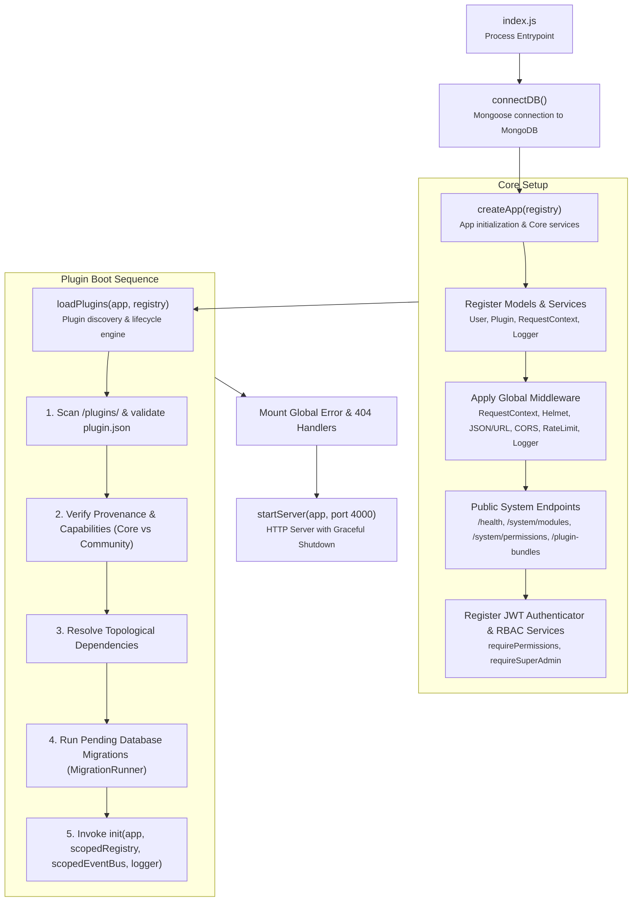
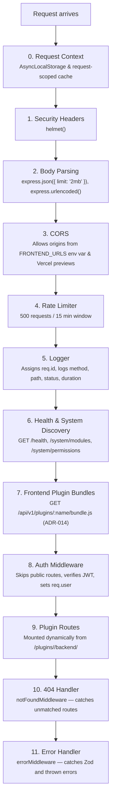
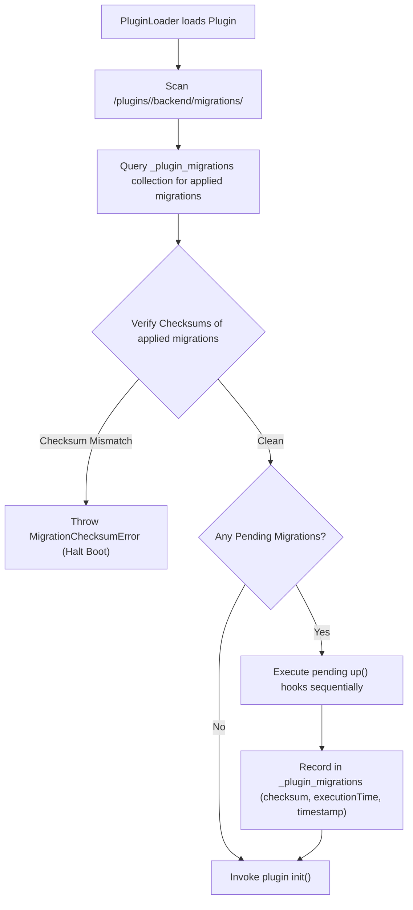
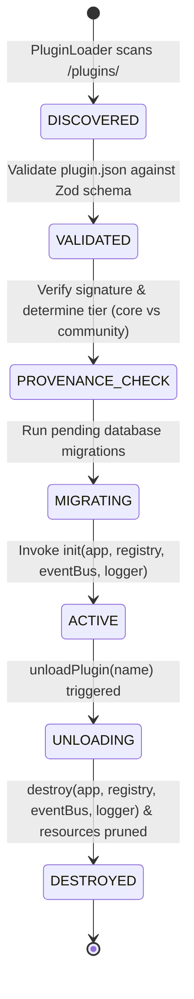

# Backend Architecture

How the CampusOS Express server actually works, traced through the source code.

> **Note**: The backend uses Express **v5** (5.2.1). This means async error handling works natively in route handlers — thrown errors are caught by the error middleware without needing `express-async-errors`.

## Startup Flow

When you run `pnpm dev` in the backend (which runs `node --watch src/index.js`), this is what happens:



1. `index.js` connects to MongoDB via `connectDB()`.
2. It passes the global `registry` singleton to `createApp()`.
3. `createApp()` registers core models (`User`, `Plugin`), RequestContext, and root logger.
4. Security middleware (`helmet`, `cors`, rate-limiting) and auth infrastructure are mounted.
5. `loadPlugins()` scans the `/plugins/` directory, validates manifests, checks dependencies, runs automated database migrations via `MigrationRunner`, and calls `init()` on each plugin.
6. `startServer()` starts listening on port `4000` with graceful shutdown handlers (`SIGTERM`, `SIGINT`).

If MongoDB is unreachable or any step fails in production, the process exits with code `1`.

## File Map

```
backend/src/
├── index.js                     # Entry point — calls connectDB → createApp → startServer
├── app.js                       # Creates Express app, loads middleware + plugins
├── server.js                    # HTTP server with graceful shutdown (SIGTERM / SIGINT)
├── plugin-loader.js             # Discovers, validates, migrates, inits & unloads plugins
│
├── core/
│   ├── event-bus.js             # Core asynchronous EventBus singleton
│   ├── sandbox-event-bus.js     # Scoped EventBus sandbox with auto-cleanup on unload
│   ├── permission-registry.js   # Dynamic atomic RBAC permission registry
│   ├── sandbox-registry.js      # Scoped ModuleRegistry sandbox with timer cleanup
│   ├── plugin-provenance.js     # Provenance verification & capability enforcement
│   ├── request-context.js       # AsyncLocalStorage-backed request cache
│   └── logger.js                # Pino structured logger with child context
│
├── auth/
│   └── jwt-authenticator.js     # JWT sign/verify, registered as authenticator('jwt')
│
├── middleware/
│   ├── auth.js                  # JWT verification, public route allowlist
│   ├── permissions.js           # requirePermissions(), requireSuperAdmin() RBAC factories
│   ├── request-context.middleware.js # Injects request-scoped store & correlation IDs
│   ├── logger.js                # Request logging with trace IDs and duration
│   └── error.js                 # Zod validation & global error handlers + 404 handler
│
├── database/
│   ├── connection.js            # Mongoose connect/disconnect/healthCheck & DatabaseManager
│   ├── migration-runner.js      # Automated forward up() & rollback down() schema migrations
│   └── schemas/                 # Core Mongoose models (User, Plugin, MigrationLog)
│
├── routes/
│   └── plugin-bundle.routes.js  # Serves compiled frontend ESM bundles & manifests (ADR-014)
│
└── utils/
    └── registry.js              # ModuleRegistry class — service locator
```

## Middleware Chain

The order in `app.js` matters. Middleware runs top-to-bottom for every request:



### Public Routes (No Auth Required)

Public routes are handled dynamically to support the plugin system:

- `GET /health` — Database health probe
- `GET /api/v1/system/modules` — List active modules
- `GET /api/v1/system/permissions` — List registered permissions grouped by module
- `GET /api/v1/plugins/:name/manifest` — Plugin manifest for frontend runtime
- `GET /api/v1/plugins/:name/bundle.js` — Compiled frontend ESM micro-bundle
- `POST /api/v1/auth/signup` & `POST /api/v1/auth/login`

Plugins dynamically register public paths via `registry.registerPublicRoute(pattern)`. The auth middleware calls `registry.getPublicRoutes()` and permits access if the request path matches. Everything else requires a valid `Bearer <token>` in the `Authorization` header.

## Automated Plugin Schema Migrations Engine

CampusOS includes an automated database migration engine (`database/migration-runner.js`, ADR-021) that runs during server boot **before** a plugin's `init()` function is invoked:



### Key Migration Features:

1. **Directory Convention**: Migrations live in `plugins/<module>/backend/migrations/` and follow lexical naming (e.g. `001_initial_schema.js`, `002_add_indexes.js`).
2. **Contract**: Each migration exports `up(context)` and `down(context)`:

   ```javascript
   export async function up({ db, mongoose, logger }) {
     await db
       .collection('calendar_events')
       .createIndex({ startTime: 1, endTime: 1 });
   }

   export async function down({ db, mongoose, logger }) {
     await db.collection('calendar_events').dropIndex('startTime_1_endTime_1');
   }
   ```

3. **Checksum Tamper-Proofing**: SHA-256 hashes of applied migrations are stored in `_plugin_migrations`. Modifying an applied migration script will prevent startup.
4. **Rollback Support**: On failure or plugin downgrade, `down()` hooks can be triggered to revert database state safely.

## Plugin Lifecycle & Teardown

CampusOS implements a full lifecycle state machine for plugins (`plugin-loader.js`, ADR-019), supporting graceful runtime deactivation, resource cleanup, and hot reloading:



### Resource Cleanup & Teardown (`destroy` Hook):

Plugins can export an optional `destroy(app, registry, eventBus, logger)` function (or `teardown`). When a plugin is deactivated:

1. **Timeout Safeguard**: `destroy()` is executed with a 5000ms timeout guard (`Promise.race`) so a hanging plugin hook cannot freeze the server.
2. **Dependency Tree Guard**: The loader verifies no other active plugin depends on this plugin before allowing deactivation (unless `force: true` is passed).
3. **Scoped Timers Cleanup**: Timers allocated via `registry.timers.setInterval()` or `setTimeout()` are automatically cleared.
4. **EventBus Listeners Unbound**: All subscriptions created via the plugin's scoped `eventBus.on()` are automatically removed to prevent memory leaks.
5. **Registry Pruning**: Services and routes registered by the plugin are pruned from the service locator.

## Service Registry & Scoped Sandboxing

The registry (`utils/registry.js`) is the central service locator and dependency injection container. It provides unified registries for business services, dynamic permissions, context resolvers, public route bypasses, stat providers, dynamic settings schemas, and leak-free scoped timers:

```javascript
registry.permissions; // Dynamic Atomic PermissionRegistry
registry.getAllModules(); // List loaded module names
registry.getAllServices(); // Map of registered services
registry.getService('serviceName'); // Retrieve shared service (with dependency validation)
registry.registerService(name, fn); // Expose service to other modules
registry.timers; // Scoped timer utilities (setInterval, setTimeout)
registry.registerContextResolver(); // Multi-tenant dynamic authorization resolver
registry.registerPublicRoute(); // Whitelist public endpoints from JWT auth
registry.registerStatProvider(); // Supply decentralized dashboard overview stats
registry.registerSettingsConfig(); // Register dynamic admin settings form schemas
```

> **Authoritative Registry Reference**: For the exhaustive method-by-method specification, context resolvers, stat providers, and sandboxed proxy examples, see [Backend Primitives & Service Registry](/docs/plugins/backend/services-and-events).

### Two-Tier Sandboxing (ADR-017):

- **Core Plugins** (`auth`, `plugin-manager`, `admin`, `club`, etc.): Granted unrestricted access to registry and core models (`grantedCapabilities: ['*']`).
- **Community Plugins**: Wrapped in a `ScopedRegistry` and `ScopedEventBus`. They can only access declared capabilities specified in their `plugin.json` manifest. Direct database access (`db:mongo`, `db:sql`, `core:models`) is blocked at the sandbox boundary.

## Dynamic Atomic RBAC

`middleware/permissions.js` exports `requirePermissions()` — a factory enforcing fine-grained atomic permissions registered dynamically by plugins:

```javascript
// Protected endpoint requiring specific atomic permission tokens:
router.post(
  '/',
  requirePermissions('event:create', 'calendar:write'),
  controller.create
);
```

### How Permissions Work:

1. When a plugin initializes, it registers its permissions via `registry.permissions.register()`:
   ```javascript
   registry.permissions.register({
     id: 'club:approve',
     module: 'club',
     label: 'Approve or Reject Club Registrations',
     description: 'Allows club administrators to transition club state'
   });
   ```
2. Dynamic permissions are queryable via `GET /api/v1/system/permissions`.
3. The RBAC middleware checks `req.user.permissions` or evaluates role-to-permission mappings dynamically, eliminating hardcoded role lists.

## Event Bus

The core EventBus (`core/event-bus.js`) enables asynchronous, decoupled communication between plugins:

```javascript
// In a service — emit domain event
eventBus.emit('club:created', { clubId, name, creatorId });

// In another plugin — listen for event
eventBus.on('club:created', async ({ clubId }) => {
  await calendarService.createClubDefaultCalendar(clubId);
});
```

- **Wildcard Subscriptions**: Supports pattern matching like `eventBus.on('club:*', handler)`.
- **Error Isolation**: Listener exceptions are caught and logged; an error in one listener never crashes the publisher or other listeners.

## Database Connection

`database/connection.js` manages MongoDB via Mongoose with high-throughput production pooling:

| Setting                    | Value   | Purpose                                      |
| -------------------------- | ------- | -------------------------------------------- |
| `serverSelectionTimeoutMS` | 5000ms  | Fast failure detection if MongoDB is down    |
| `socketTimeoutMS`          | 45000ms | Prevents hanging operations on stale sockets |
| `maxPoolSize`              | 10      | Concurrent connection pool limit             |
| `minPoolSize`              | 2       | Keeps warm connections ready                 |

Default URI: `mongodb://localhost:27017/campusos`  
Exports: `connectDB()`, `disconnectDB()`, `healthCheck()`, `isDBConnected()`, `databaseManager`.

## Testing Strategy

Testing in the CampusOS backend uses **Vitest** paired with **MongoDB Memory Server**:

1. **In-Memory Database**: Unit and integration tests instantiate a fresh in-memory MongoDB replica. No external Docker container or live database is needed.
2. **Per-Plugin Isolation**: Each plugin has its own test suite running with isolated schemas and clean collections.
3. **Mongoose Best Practices**: Tests verify modern Mongoose operations, enforcing `{ returnDocument: 'after' }` over deprecated options.
4. **Lifecycle & Migration Tests**: Dedicated test suites in `plugin-lifecycle.test.js` and `migration-runner.test.js` verify hook timeouts, rollbacks, and sandboxing under stress.
5. **Execution**:
   ```bash
   pnpm test                  # Run all tests across workspace
   pnpm -C plugins/calendar test -- --run   # Test a specific plugin
   ```

---

**See Also**: [Plugin System](./PLUGIN_SYSTEM.md) · [Architecture Overview](./OVERVIEW.md) · [Database Setup](../getting-started/DATABASE_SETUP.md) · [Event Catalog](./EVENT_CATALOG.md)
