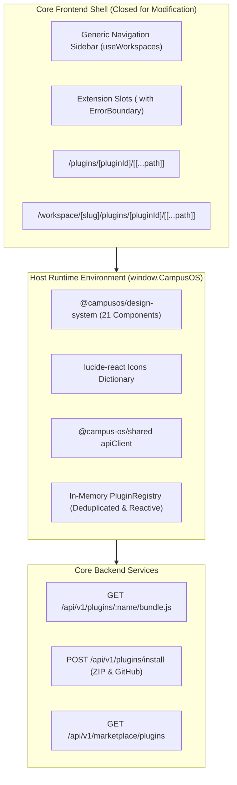

# ADR-018: Zero-Touch Frontend Architecture and Generic Dynamic Catch-All Routing

## Status

Accepted

## Context

Following the adoption of Runtime ESM Bundle Injection in ADR-014, CampusOS backend services and extension mechanisms operated dynamically. However, the core Next.js frontend remained statically coupled to plugins at compile-time:

1. **CLI File Generation in Core Tree:** The CLI installer (`scripts/plugin.js:generateNextjsWrapper`) physically created dozens of static Next.js routing wrapper files inside `frontend/app/(dashboard)/<plugin>/page.tsx` and `frontend/app/(workspace)/workspace/[slug]/<plugin>/page.tsx`. This modified the core repository working tree, polluted source control, and required rebuilding the Next.js shell for each installed plugin.
2. **Hardcoded Core Navigation Coupling:** The primary navigation sidebar (`frontend/components/AppSidebar.tsx`) directly imported plugin-specific hooks (`import { useClubs } from '@plugins/club/frontend/hooks'`) and maintained a static 7-icon dictionary, violating the Dependency Inversion Principle (DIP).
3. **Slot Fragility and Lack of Teardown:** `<ExtensionPoint />` lacked deduplication and lifecycle unregistration. When plugins were disabled, their widgets remained cached in memory and visible in the DOM until a full page reload.
4. **No Web-Based Plugin Installation:** Sideloading plugins via `.zip` upload or community marketplace was impossible because plugin addition depended on local CLI script execution.

A true modular operating system requires a **"Zero-Touch Core Frontend"**: once deployed to production, the core Next.js web application is closed for modification. All plugin pages, navigation items, and micro-widgets must mount dynamically at runtime.

---

## Decision

CampusOS adopts a **Zero-Touch Modular Frontend Architecture** consisting of five architectural pillars:

### 1. Generic Catch-All Dynamic Routing

Static plugin wrapper routes in `frontend/app/` are deprecated and replaced by two generic catch-all routes:

- **Global Plugin Catch-All Route:**  
  `frontend/app/(dashboard)/plugins/[pluginId]/[[...path]]/page.tsx`  
  Captures all global plugin requests (e.g., `/plugins/hackathon-portal`, `/plugins/admin/settings`).
- **Workspace-Scoped Catch-All Route:**  
  `frontend/app/(workspace)/workspace/[slug]/plugins/[pluginId]/[[...path]]/page.tsx`  
  Captures all workspace/club plugin requests (e.g., `/workspace/robotics/plugins/budget`, `/workspace/coding/plugins/recruitment/rounds`).

Both catch-all pages extract `pluginId`, `slug`, and sub-routes, passing them to `DynamicPluginHost.tsx`. Legacy route URLs (e.g. `/activity`, `/recruitment`) are preserved via Next.js server rewrites (`next.config.ts`), ensuring 100% backward compatibility with zero hardcoded files.

### 2. Inverted Navigation & Dynamic Icon Resolution

Core layouts are completely decoupled from plugin implementations:

- **Generic Workspaces Hook (`useWorkspaces`):** Replaces direct plugin hook imports by fetching active club/workspace workspaces through `apiClient.get('/clubs')`.
- **Dynamic Icon Resolver (`DynamicIcon`):** Resolves icon names dynamically from the exposed `lucide-react` library at runtime with safe fallbacks, eliminating static icon lookup maps.
- **Reactive Sidebar Updates:** `AppSidebar` subscribes to `registry.subscribe(listener)`, dynamically rendering navigation links as plugins are enabled or disabled without page refresh.

### 3. Fault-Tolerant, Deduplicated Extension Slots

`<ExtensionPoint />` and `PluginRegistry` are enhanced for zero-downtime lifecycles:

- **Deduplication:** Prevents duplicate widget or sidebar link registrations during Hot Module Replacement (HMR) or repeat initialization calls.
- **Dynamic Unregistration (`unregisterPlugin`):** When a plugin is disabled, `registry.unregisterPlugin(pluginId)` removes all widgets and navigation links registered by that plugin.
- **Observer Pattern (`subscribe` / `notify`):** Extension slots reactively re-render in real-time when the registry state changes.
- **Isolated Error Boundaries:** Each widget inside an `<ExtensionPoint />` is wrapped in an individual error boundary, ensuring a third-party widget crash does not affect the host page.

### 4. Complete Host Runtime Environment (`window.CampusOS`)

Core dependencies are exposed on the browser global window object:

- **`window.CampusOS` / `window.__CampusOS_Runtime__`:**
  - `React` & `ReactDOM`
  - `ui`: Complete `@campusos/design-system` (all 21 UI components)
  - `icons`: All `lucide-react` icon components
  - `apiClient`: Shared authenticated API client
  - `registry`: Singleton `PluginRegistry`
- **Compiler Shims:** `scripts/build-plugin-frontend.js` compiles plugin source code via `esbuild`, resolving `@campusos/design-system`, `@campus-os/shared`, and `lucide-react` to host virtual modules, eliminating bundle duplication.

### 5. Web-Based Sideloading & Central Community Marketplace

- **Backend Package Installation API:** `POST /api/v1/plugins/install` accepts `.zip` file uploads or GitHub archive URLs, performs Zip Slip and manifest schema checks, runs automatic esbuild frontend compilation if necessary, updates database records, and emits `plugin:installed` events.
- **Super Admin Sideload UI:** An integrated drag-and-drop `.zip` upload zone with progress indicators and error feedback.
- **Community Marketplace Store:** An in-app store UI (`GET /api/v1/marketplace/plugins`) allowing administrators to audit plugin capabilities and trigger 1-click installation.

---

## Architecture Diagram

---

## Consequences

### Positive

- **Zero Core Modification:** Installing or removing a plugin never modifies `frontend/app/` or any file in the core frontend codebase.
- **Zero-Rebuild Lifecycle:** Administrators can install, configure, enable, or disable plugins in production without triggering a Next.js build or redeployment.
- **Instant Teardown:** Disabling a plugin immediately purges its UI from extension points and navigation bars without requiring a browser refresh.
- **Fault Tolerance:** Third-party widget crashes are isolated to their specific slot without degrading core platform stability.
- **Community-Ready Ecosystem:** Developers can package, test, distribute, and publish plugins as standalone `.zip` archives or GitHub releases.

### Negative

- **Dynamic Module Latency:** Initial navigation to an un-cached plugin requires an HTTP fetch of its ESM bundle (`/bundle.js`), mitigated by HTTP caching headers and browser asset caching.
- **Runtime Dependency Synchronization:** Plugins relying on `@campusos/design-system` must use component APIs compatible with the versions exposed by the host shell.
