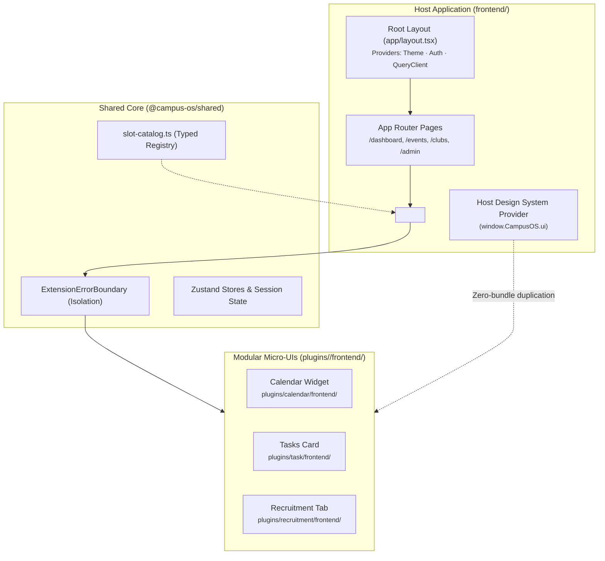
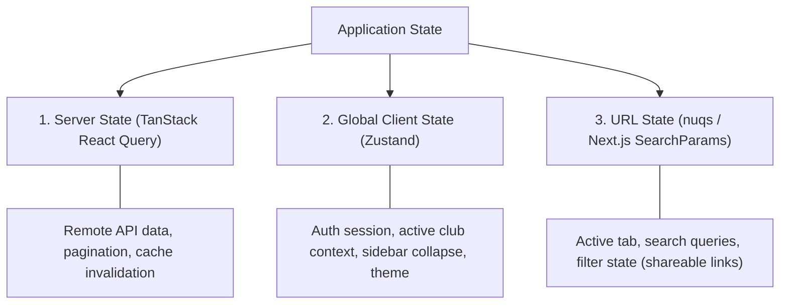

# Frontend Architecture Overview

The CampusOS frontend is built with **Next.js 16 (App Router)**, **React 19**, **TypeScript**, and **Tailwind CSS v4**. It implements a hybrid architecture: a fast, server-rendered host application combined with a dynamic **Slot-Fill micro-UI runtime** that enables plugins to inject interactive widgets without requiring whole-app rebuilds.

---

## 1. Core Architecture Diagram



---

## 2. Tech Stack

| Technology         | Version | Architectural Role                                             |
| ------------------ | ------- | -------------------------------------------------------------- |
| **Next.js**        | 16.x    | App Router, Server Components (RSC), Turbopack compilation     |
| **React**          | 19.x    | UI library, React Compiler optimizations, concurrent rendering |
| **TypeScript**     | 5.x     | End-to-end type safety with shared interfaces                  |
| **Tailwind CSS**   | v4      | Modern utility-first CSS styling with OKLCH color variables    |
| **shadcn/ui**      | Latest  | Accessible Radix UI primitives tokenized for dark/light mode   |
| **Zustand**        | 5.x     | Lightweight, decoupled client-side state stores                |
| **TanStack Query** | 5.x     | Async server state, caching, and optimistic mutations          |
| **Lucide React**   | Latest  | Unified icon library                                           |

---

## 3. Directory Layout

```
frontend/
├── app/                          # Next.js App Router (Pages, Layouts & Route Handlers)
│   ├── (auth)/                   # Route group: /login, /signup, /forgot-password
│   ├── (dashboard)/              # Protected dashboard layouts & navigation
│   │   ├── dashboard/            # Main dashboard overview
│   │   ├── clubs/                # Club exploration & management
│   │   ├── events/               # Event planning & listings
│   │   ├── tasks/                # Kanban task boards
│   │   └── calendar/             # Interactive schedule & calendar
│   ├── layout.tsx                # Root layout with fonts, ThemeProvider & Toast
│   ├── page.tsx                  # Public landing portal
│   └── globals.css               # Tailwind CSS v4 variables & color scales
│
├── components/                   # Core shared UI components
│   ├── layout/                   # Navbar, Sidebar, Breadcrumbs, UserDropdown
│   ├── providers/                # ThemeProvider, QueryClientProvider, AuthProvider
│   └── ui/                       # @campusos/design-system (Button, Card, Dialog, Form, etc.)
│
├── lib/                          # Client utilities and state stores
│   ├── api/                      # Central API client & error normalizers
│   ├── stores/                   # Zustand global stores (auth, UI, preferences)
│   └── hooks/                    # Reusable React hooks
│
└── plugins/                      # (Moved to monorepo root: plugins/<name>/frontend/)
```

---

## 4. State Management Strategy (Zustand + React Query)

CampusOS follows a 3-tier state separation to eliminate unnecessary re-renders:



### Zustand Store Example:

```typescript
// frontend/lib/stores/use-auth-store.ts
import { create } from 'zustand';
import { persist } from 'zustand/middleware';

interface User {
  id: string;
  name: string;
  email: string;
  role: string;
}

interface AuthState {
  user: User | null;
  token: string | null;
  setSession: (user: User, token: string) => void;
  clearSession: () => void;
}

export const useAuthStore = create<AuthState>()(
  persist(
    (set) => ({
      user: null,
      token: null,
      setSession: (user, token) => set({ user, token }),
      clearSession: () => set({ user: null, token: null })
    }),
    { name: 'campusos-auth-session' }
  )
);
```

---

## 5. Slot-Fill Micro-UI Extension Points (ADR-020)

CampusOS uses the **Slot-Fill System** (`@campus-os/shared`) to allow plugins to register UI components into pre-defined locations across the host app:

### 1. In Host Pages:

```tsx
import { ExtensionPoint } from '@campus-os/shared';

export function DashboardPage({ user, currentClub }) {
  return (
    <div className="space-y-6">
      <header className="flex justify-between">
        <h1>Dashboard</h1>
        {/* Actions slot in header */}
        <ExtensionPoint
          name="header.actions"
          context={{ user, club: currentClub }}
        />
      </header>

      {/* Grid of plugin widgets */}
      <div className="grid grid-cols-1 md:grid-cols-3 gap-6">
        <ExtensionPoint
          name="dashboard.widget"
          context={{ user, club: currentClub }}
        />
      </div>
    </div>
  );
}
```

### 2. Available Extension Slots:

Defined in `shared/src/slot-catalog.ts`:

- `dashboard.widget` — Dashboard cards and analytical KPI widgets
- `header.actions` — Action buttons in top navigation
- `sidebar.nav` — Navigation items injected into main sidebar
- `event.details.tab` — Additional tabs on event pages (e.g. Budget, Check-in, Scheduling)
- `club.profile.section` — Custom sections on club profile pages
- `user.profile.tab` — Custom profile panels

### 3. Error Boundary Isolation:

Every widget injected through `<ExtensionPoint />` is wrapped inside an `ExtensionErrorBoundary`. If a community plugin widget throws a JavaScript error, it displays a compact fallback alert without breaking the rest of the host page:

```tsx
<ExtensionErrorBoundary pluginId="vendor-widget">
  <VendorWidget context={context} />
</ExtensionErrorBoundary>
```

---

## 6. Runtime ESM Plugin Bundling (ADR-014 & ADR-031)

To keep bundle sizes small and avoid rebuilding the Next.js app whenever a plugin changes:

1. **Dynamic Micro-Bundles**:
   Frontend plugins are compiled into standalone ESM files served directly by the backend:
   `GET /api/v1/plugins/:name/bundle.js`
2. **Host Virtual Module Injection**:
   The host application exposes React, ReactDOM, and `@campusos/design-system` globally via `window.CampusOS.ui`.
3. **Zero Redundant Downloads**:
   Plugins import UI primitives directly from the shared runtime. A plugin bundle is typically under 15KB!

---

## 7. Centralized API Client

All network requests use the typed client (`shared/src/api-client.ts` or `frontend/lib/api/client.ts`):

```typescript
import { apiClient } from '@/lib/api/client';

export async function fetchEventDetails(eventId: string) {
  // Automatically attaches Bearer token from authStore and normalizes errors
  return apiClient.get<EventDetails>(`/api/v1/events/${eventId}`);
}
```

- **Prefix Resolution**: Automatically prepends `/api/v1` and the backend port (4000 in local dev).
- **Zod Error Extraction**: Parses structured validation errors from backend error responses.

---

**See Also**: [Design System Guide](./DESIGN_SYSTEM.md) · [Dark Mode Support](./DARK_MODE.md) · [Slot Catalog](../plugins/frontend/SLOT_CATALOG.md)
