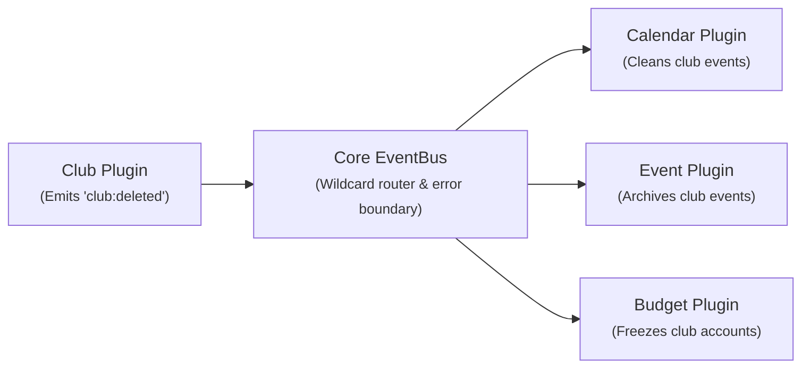
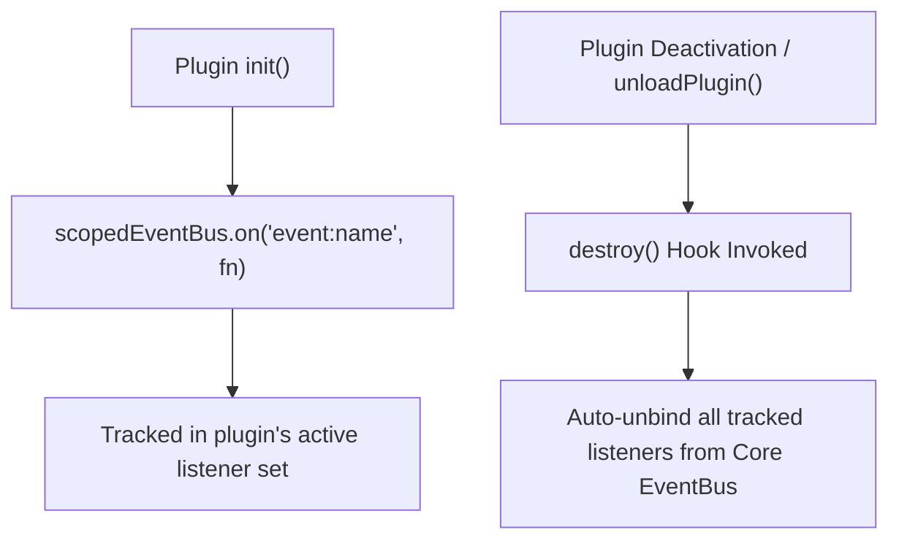

# Inter-Plugin Communication via EventBus

In CampusOS, plugins **never import code or services from other plugins directly**. Instead, cross-module communication is handled through an asynchronous, event-driven pub/sub architecture powered by the **Core EventBus** (`core/event-bus.js`).

---

## 1. Why Event-Driven Decoupling?

In a modular monorepo, direct dependencies between plugins create tight coupling:

- ❌ **Anti-pattern**: `import { deleteCalendarEvents } from '../../calendar/service.js'` inside `plugins/club/`. If the `calendar` plugin is disabled or uninstalled, the `club` plugin crashes on boot!
- ✅ **CampusOS Pattern**: `eventBus.emit('club:deleted', { clubId })`. The `club` plugin doesn't know or care whether the calendar plugin is enabled. If enabled, the calendar plugin listens and cleans up its own records.



---

## 2. EventBus API & Usage

Plugins receive the `eventBus` instance in their `init()` entrypoint:

```javascript
// plugins/calendar/backend/src/index.js
export async function init(app, registry, eventBus, logger) {
  // 1. Subscribe to specific domain events
  eventBus.on('event:published', async (payload) => {
    logger.info({ eventId: payload.eventId }, 'Received event:published');
    await calendarService.syncPublishedEvent(payload);
  });

  // 2. Subscribe with wildcards
  eventBus.on('club:*', async (payload) => {
    logger.info('Club domain change detected', payload);
  });
}
```

### Emitting Events:

When an entity state changes in your plugin service layer, publish an event:

```javascript
// plugins/event/backend/src/service/event.service.js
export function createEventService(repository, { eventBus, logger }) {
  return {
    async publish(eventId) {
      const event = await repository.updateStatus(eventId, 'PUBLISHED');

      // Emit domain event to EventBus
      if (eventBus) {
        eventBus.emit('event:published', {
          eventId: event._id,
          clubId: event.clubId,
          title: event.title,
          startTime: event.startTime,
          endTime: event.endTime,
          venue: event.venue
        });
      }

      return event;
    }
  };
}
```

---

## 3. Event Naming Conventions

All domain events in CampusOS adhere to the standard lower-case colon-separated format:

$$\text{namespace} : \text{action}$$

Examples:

- `auth:user_registered`
- `club:created`, `club:approved`, `club:deleted`
- `event:created`, `event:published`, `event:cancelled`
- `budget:approved`, `budget:expense_logged`
- `recruitment:candidate_accepted`

For the complete dictionary of recognized event schemas, refer to the [Event Catalog](../architecture/EVENT_CATALOG.md).

---

## 4. Resilience & Error Isolation

The Core EventBus implements built-in error isolation:

1. **Asynchronous Execution**: Listeners run in isolated promise chains so the publisher never blocks on long-running subscriber operations.
2. **Listener Crash Isolation**: If listener A throws an unhandled error, the EventBus logs the stack trace with context and continues executing listener B, C, and D without failing the HTTP request.
3. **Idempotency**: Because network retries or distributed events may deliver duplicates, subscribers should check database state or unique constraints before inserting duplicate records.

---

## 5. Automatic Teardown & Scoped Sandboxing (ADR-019 & ADR-017)

Every plugin receives a **Scoped EventBus** (`core/sandbox-event-bus.js`):



When a plugin is disabled or reloaded:

- All listeners registered via `scopedEventBus.on()` are automatically unbound.
- No zombie callbacks remain in memory.
- Community plugins can only emit or listen to events declared in their `plugin.json` manifest capabilities (`"capabilities": ["events:emit", "events:listen"]`).

---

**See Also**: [Event Catalog](../architecture/EVENT_CATALOG.md) · [Plugin Development Guide](./plugin-development.md) · [Backend Architecture](../architecture/BACKEND.md)
